<div align="center">
  <a href="https://rxfatih-2.github.io/Portofolio-/">
    
  </a>

  <p align="center">
    <a href="https://rxfatih-2.github.io/Portofolio-/"></a>
    <a href="https://github.com/rxfatih-2"></a>
    
  </p>
</div>

---

### Pratinjau Video Gerbang & Latar

TEMPEL_LINK_USER_ATTACHMENTS_DARI_ISSUE_DI_SINI

---

### Fitur Utama Website

* **Gerbang Pembuka 3D Shoji Split (`Full-Landscape 16:9`):** Menampilkan video gerbang secara utuh di layar ponsel maupun desktop, dilengkapi cincin segel berputar, gelombang kejut (*chakra shockwave*), percikan bara, serta dua daun pintu kisi Jepang 3D yang membelah saat diketuk.
* **Manajemen Sesi Pintar (`sessionStorage`):** Gerbang hanya muncul saat pengunjung baru masuk ke web utama dan tidak mengulang saat pengunjung membuka salah satu dari 6 situs karya lalu kembali.
* **Backsound Otomatis Berbasis Interaksi:** Audio latar menyala otomatis pada sentuhan atau guliran (*scroll*) pertama di halaman utama, disertai tombol kontrol **Audio On/Off** di bilah navigasi.
* **Deteksi Orientasi & Aset Otomatis:** Menyesuaikan rotasi video miring (`90°`) secara otomatis dan memuat aset lokal dengan mulus.

---

### Etalase 06 Website & Aplikasi Aktif

| No | Nama Karya | Kategori | Tautan Live |
| :--- | :--- | :--- | :--- |
| **01** | **Undangan Digital Adat Sunda** | Undangan Adat | [Buka Situs](https://rxfatih-2.github.io/Sunda-wedding-/) |
| **02** | **Undangan Digital Adat Bugis** | Undangan Adat | [Buka Situs](https://rxfatih-2.github.io/Bugis-wedding-/) |
| **03** | **Undangan Digital Adat Minangkabau** | Undangan Adat | [Buka Situs](https://rxfatih-2.github.io/Minangkabau-wedding-/) |
| **04** | **Undangan Digital Tema Super Mario** | Tema Interaktif | [Buka Situs](https://rxfatih-2.github.io/Mario-wedding-/) |
| **05** | **Website HUT ke-10 Perusahaan** | Situs Korporat | [Buka Situs](https://rxfatih-2.github.io/web-hut-perusahaan-/) |
| **06** | **Permainan Catur Berbasis Web** | Game Browser | [Buka Situs](https://rxfatih-2.github.io/Game-asah-otak-super/) |

---

### Struktur Direktori

```text
Portofolio-/
├── index.html          # Struktur semantik, gerbang video 3D, & modal detail proyek
├── style.css           # Sistem desain gelap, animasi pintu shoji, & tata letak responsif
├── script.js           # Kontrol sesi gerbang, auto-backsound, & resolver media otomatis
├── README.md           # Dokumentasi repositori & pratinjau animasi
└── assets/
    ├── banner.svg      # Banner animasi vektor untuk dokumentasi GitHub
    ├── video_1.mp4     # Video latar utama
    ├── 972f27f6.mp4    # Video gerbang pembuka (16:9 landscape)
    ├── foto-formal.jpg # Potret profil M Rizki Akbar
    └── bgm.mp3         # Audio latar halaman utama
